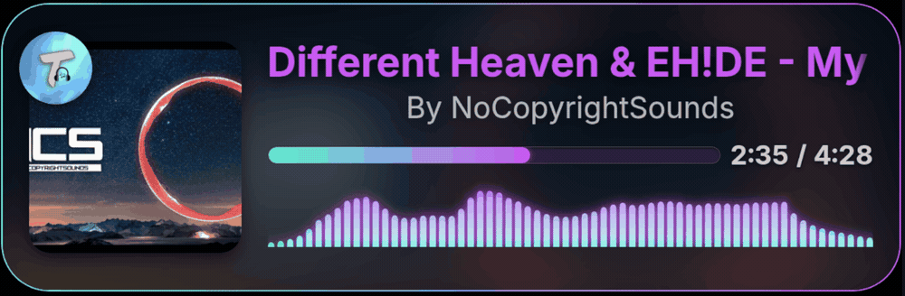

# T_Music_Bot RPC (Rust)

A Discord Rich Presence client and OBS overlay for **T_Music_Bot**. Written in native Rust, one codebase for Windows, macOS and Linux, and it stays in your system tray once it's paired. The idea is simple: something you can leave running all day without ever noticing it's there.

<p align="center">
  
</p>

---

## Performance & Resource Footprint

Measured on Linux (AMD Ryzen 5600G / CachyOS) and Windows 11:
- **Idle CPU:** `< 0.2%` (strict target `< 1.0%`). Capture suspends automatically when idle or unlistened.
- **Memory (RSS):** Flat `~40 MB` across runs. No leaks, zero garbage collection pauses.

---

## Layout Modes & Visualizer

Everything is configured from the web dashboard at `http://localhost:3000/settings` — double-click the tray icon to open it. The overlay OBS captures has three layouts:

- **Full** — cover art, track info, progress bar and spectrum bars along the bottom. When playback pauses, the background dims behind a blur.
- **Compact bar** — track info side-by-side with the spectrum bars. Sits nicely on the top or bottom edge of a frame.
- **Compact minimal** — a small card with the avatar and track name. Fits in a corner without eating screen space.

#### OBS Studio Quick Setup
Add an **OBS Browser Source** pointing to `http://localhost:3000`:
- **Dimensions:**
  - **Full Layout:** `1360 x 440`
  - **Compact Bar:** `800 x 200`
  - **Compact Minimal:** `540 x 100`
- **Instant Scene Overrides:** Override the active layout per scene by appending query parameters directly to the Browser Source URL:
  - `http://localhost:3000/?layout=full` (Full banner with blurred art)
  - `http://localhost:3000/?layout=compact-bar` (Horizontal bar for screen edges)
  - `http://localhost:3000/?layout=compact-minimal` (Corner card)

### Spectrum Engine

The visualizer captures desktop audio through CPAL native loopbacks — WASAPI loopback on Windows, PulseAudio/PipeWire on Linux, CoreAudio on macOS — so it sees whatever your system is already playing, virtual cables like VB-Cable or Voicemeeter included.

- Bands can be spaced logarithmically (matches how ears hear, more resolution down in the bass) or linearly (even spread across the whole range).
- Capture suspends itself when no overlay is listening or nothing is playing, so idle cost is basically nothing.
- Bar inertia has three presets: `Reactive` for fast electronic tracks, `Balanced` as a middle ground, `Smooth` if you'd rather watch slow movement for hours.

### Colors

Take the palette straight from the album cover and the text, bars and borders all follow it. Or lock a static gradient, or shuffle your own palette on every new track. There's a neon glow option behind the bars too — it looks good, but it's the first thing to switch off if your GPU is already busy.

---

## Installation & Getting Started

Download the package for your operating system from the [Releases](https://github.com/T-Bot-Team/t-music-bot-rpc/releases) page:

### Windows (64-bit)
1. Download **`T_Music_Bot_RPC.zip`**.
2. Extract the folder anywhere you want (e.g. `C:\Program Files\T_Music_Bot_RPC`, Desktop, or any preferred directory). The application is fully portable and runs from anywhere.
3. Run `T_Music_Bot_RPC.exe`.
4. The client runs in the background and appears in your System Tray notification area.
5. **Autostart:** To run on boot, place a shortcut of `T_Music_Bot_RPC.exe` in `shell:startup` (Press `Win + R` -> type `shell:startup` -> Paste shortcut) or enable it from the web dashboard.

### macOS (Apple Silicon & Intel)
1. Download the `.dmg` matching your Mac processor:
   - **Apple Silicon (M1 / M2 / M3 / M4):** **`T_Music_Bot-RPC_Apple_Silicon.dmg`**
   - **Intel Core:** **`T_Music_Bot-RPC_Intel.dmg`**
2. Open the DMG and drag `T_Music_Bot_RPC.app` into your `Applications` folder.
3. The app is packaged as a tray-only agent (`LSUIElement`), sitting in your macOS menu bar without taking up space in the Dock.
4. **Gatekeeper (Unsigned / Ad-hoc builds):**
   If macOS shows *"App cannot be opened because Apple cannot check it for malicious software"*:
   - Right-click (or Control-click) `T_Music_Bot_RPC.app` in Finder, choose **Open**, and click **Open** in the dialog.
   - Or open Terminal and run: `xattr -cr /Applications/T_Music_Bot_RPC.app`
5. *Why not a universal binary?* Standalone binaries keep the download lean (~15 MB) instead of doubling download size (~35 MB) for everyone with dead architecture code.

### Linux (x86_64)
1. Download **`T_Music_Bot-RPC.tar.gz`**.
2. **Runtime Dependencies:** Ensure the following system libraries are installed:
   - **Ubuntu / Debian:** `sudo apt install libgtk-3-0 libpulse0 openssl`
   - **Arch Linux / CachyOS / Manjaro:** `sudo pacman -S gtk3 libpulse openssl`
   - **Fedora:** `sudo dnf install gtk3 pulseaudio-libs openssl`
3. **GNOME Desktop System Tray Note:**
   Modern GNOME (3.26+) does not display tray icons by default. If running GNOME (default on Ubuntu / Fedora), install the **AppIndicator and KStatusNotifierItem Support** extension:
   ```bash
   # Ubuntu / Debian
   sudo apt install gnome-shell-extension-appindicator
   # Fedora
   sudo dnf install gnome-shell-extension-appindicator
   ```
   *(KDE Plasma, XFCE, Cinnamon, and MATE display the tray icon out of the box).*
4. **Desktop Integration:**
   Extract and install the binary and launcher:
   ```bash
   tar -xzf T_Music_Bot-RPC.tar.gz
   cd T_Music_Bot-RPC
   cp T_Music_Bot-RPC ~/.local/bin/
   cp icon.png ~/.local/share/icons/hicolor/256x256/apps/t-music-bot-rpc.png
   cp t-music-bot-rpc.desktop ~/.local/share/applications/
   ```

---

## Configuration Settings

Settings live in `settings.json`:
- **Windows:** `%APPDATA%\T_Music_Bot_RPC\settings.json`
- **macOS:** `~/Library/Application Support/T_Music_Bot_RPC/settings.json`
- **Linux:** `~/.config/t-music-bot-rpc/settings.json`

Open it straight from the **Open settings.json** button on the dashboard (`http://localhost:3000/settings`), or use the sliders — both write to the same file.

| Section | Key | Default | Description |
| :--- | :--- | :--- | :--- |
| **Core** | `code` | `""` | 6-digit Discord pairing authorization code. |
| **Core** | `userId` | `""` | Numeric Discord User ID (auto-detected on connect). |
| **Overlay** | `port` | `3000` | Web server port for dashboard (`/settings`) and overlay (`/`). |
| **Overlay** | `layout` | `"full"` | Active layout (`"full"`, `"compact-bar"`, or `"compact-minimal"`). |
| **Audio** | `manageBus` | `false` | Linux only. Creates a dedicated virtual sink so the visualizer always reads full-volume output, while `listenVolume` controls what you hear — lowering your volume no longer flattens the bars. On Windows and macOS, use VB-Cable/Voicemeeter instead (see the routing guide above). |
| **Audio** | `listenVolume` | `75` | What you hear from the managed bus, in percent (`0 - 150`). |
| **Visualizer** | `enabled` | `false` | Enable/disable CPAL audio loopback visualizer engine. |
| **Visualizer** | `audioDevice` | `"default"`| Capture device id. `"default"` = desktop audio (WASAPI loopback on Windows, default monitor source on Linux, virtual loopback/mic on macOS). Custom values are stable device ids persisted from the picker; devices are displayed Windows-style as `Name (ID)`, and legacy name-based settings still resolve. |
| **Visualizer** | `fps` | `60` | Spectrum rendering frames per second (`30 - 240`). |
| **Visualizer** | `samples` | `4096` | FFT frequency window size (`512 - 16384`). |
| **Visualizer** | `bars` | `64` | Visualizer frequency bars count. |
| **Visualizer** | `smoothing` | `6` | Inertia/decay inertia coefficient (`1 - 20`). |
| **Visualizer** | `sensitivity`| `45` | Lower threshold in decibels for bar scaling (`10 - 100`). |
| **Visualizer** | `multiplier` | `25` | Height multiplier scaling factor. |

---

## Guides & Documentation

* 🔌 **[Audio Isolation & Routing Guide](https://github.com/T-Bot-Team/t-music-bot-rpc/wiki/Audio-Isolation-&-Routing-Guide)** — keeping games, voice chat and system sounds out of the visualizer using VB-Cable, Voicemeeter, or PipeWire/CoreAudio.
* 🖥️ **[OBS Studio Integration Tour](https://github.com/T-Bot-Team/t-music-bot-rpc/wiki/OBS-Studio-Integration-Tour)** — browser source setup, viewport scaling, transparency filters, performance settings.
* 🎛️ **[Dashboard Tour](https://github.com/T-Bot-Team/t-music-bot-rpc/wiki/Dashboard-Tour)** — what every setting in the control panel actually does.
* ⚡ **[Performance Benchmarks](https://github.com/T-Bot-Team/t-music-bot-rpc/wiki/Performance-Benchmarks)** — CPU/RAM numbers for this Rust build against the old TypeScript client.
* 🛠️ **[Compiling Guide](https://github.com/T-Bot-Team/t-music-bot-rpc/wiki/Compiling-Guide)** — building from source, with a walkthrough of the codebase.
* 🤝 **[Contributing Guidelines](https://github.com/T-Bot-Team/t-music-bot-rpc/wiki/Contributing-Guidelines)** — workflow, code expectations, how to send a PR.

---

## License
[CC BY-NC-ND 4.0](LICENSE)
